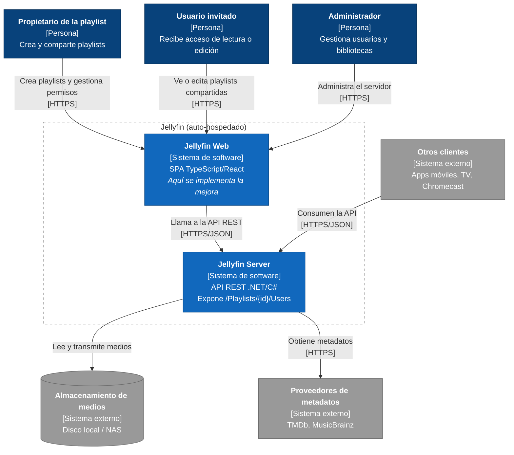

# C4 — Nivel 1: Diagrama de contexto

> Alcance: Jellyfin con la mejora propuesta (gestión de permisos de playlists compartidas, issue [jellyfin-web#4698](https://github.com/jellyfin/jellyfin-web/issues/4698)).
> Versión base: Jellyfin `v12.1` (2026-09-15).
> Notación C4 representada con `flowchart` de Mermaid para una distribución legible.

Siguiente nivel: [C4 nivel 2 — Contenedores](c4-nivel2-contenedores.md).
