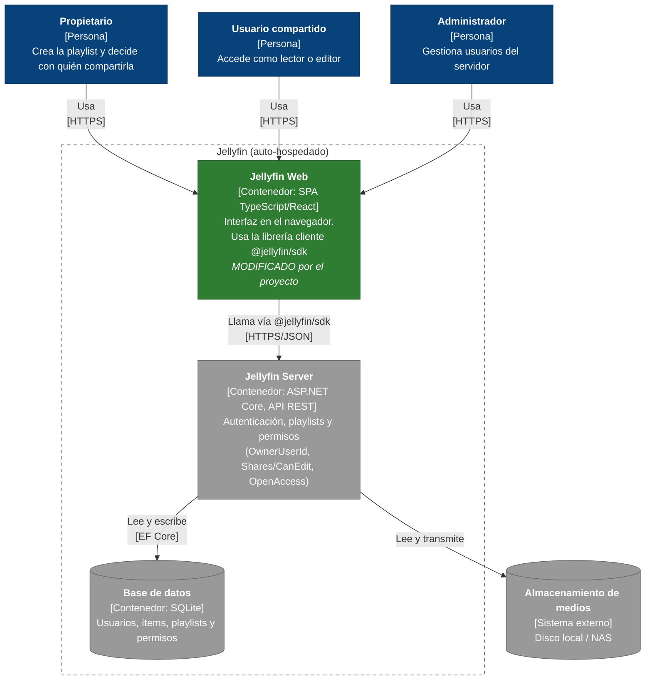

# C4 — Nivel 2: Diagrama de contenedores

> Alcance: contenedores de Jellyfin relevantes para compartir playlists (issue [#5](https://github.com/jabarcar-cenfotec/pswe07-CenfoCore-Jellyfin-web/issues/5)).
> Nivel anterior: [C4 nivel 1 — Contexto](c4-nivel1-contexto.md). Nivel siguiente: [C4 nivel 3 — Componentes](c4-nivel3-componentes-playlist.md).
> Notación C4 representada con `flowchart` de Mermaid. **Verde** = contenedor que el proyecto modifica; **gris** = sin cambios.

## Contenedores

| Contenedor | Tecnología | Responsabilidad | ¿Cambia en el proyecto? |
|---|---|---|---|
| Jellyfin Web | TypeScript, React y módulos legacy; webpack | Interfaz de usuario; muestra y edita playlists | **Sí**: nueva sección "Compartido con" en el editor de playlist |
| `@jellyfin/sdk` | Librería TypeScript (dependencia npm de Jellyfin Web) | Cliente generado de la API REST | No; se usa tal cual |
| Jellyfin Server | .NET / ASP.NET Core | API REST; aplica permisos de playlist | No; ya expone `/Playlists/{playlistId}/Users` |
| Base de datos | SQLite | Persistencia de usuarios, playlists y permisos | No |
| Almacenamiento de medios | Sistema de archivos / NAS | Archivos de audio y video | No |

## Decisiones

- El proyecto **solo modifica el cliente web**: el modelo de permisos ya existe en el servidor (jellyfin#9466), pero la interfaz web no lo expone (jellyfin-web#4698).
- La comunicación con el servidor se hace exclusivamente mediante `@jellyfin/sdk`; no se agregan endpoints ni cambios de esquema.
