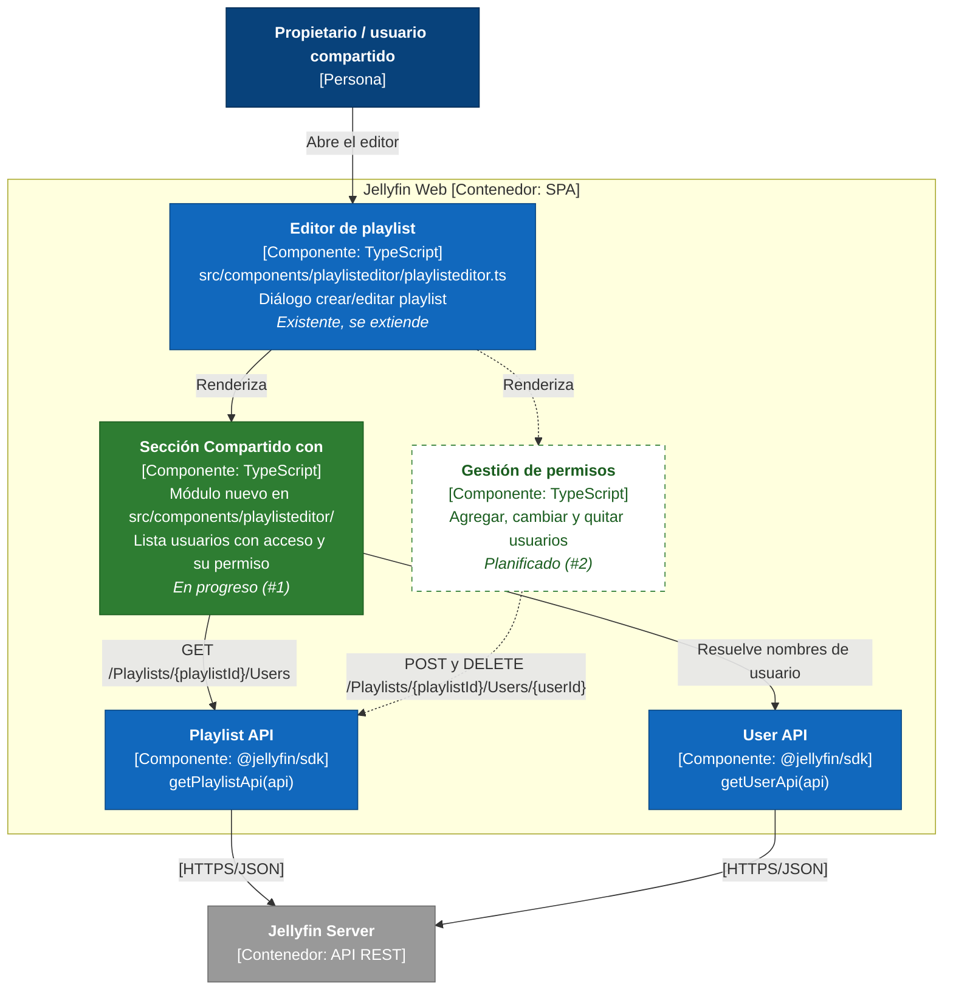
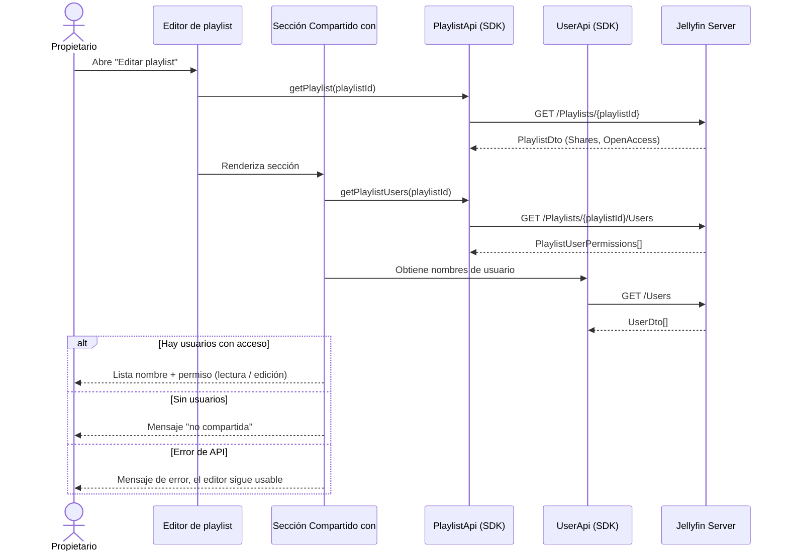

# C4 — Nivel 3: Componentes de "Compartido con" (Jellyfin Web)

> Alcance: componentes del contenedor **Jellyfin Web** que participan en compartir playlists.
> Nivel anterior: [C4 nivel 2 — Contenedores](c4-nivel2-contenedores.md).
> Estado: **en progreso** = issue [#1](https://github.com/jabarcar-cenfotec/pswe07-CenfoCore-Jellyfin-web/issues/1) (Entregable 2); **planificado** = issue [#2](https://github.com/jabarcar-cenfotec/pswe07-CenfoCore-Jellyfin-web/issues/2) (Entregable final).

Líneas punteadas = planificado (#2).

## Endpoints usados (confirmados en `@jellyfin/sdk`, `lib/generated-client/api/playlist-api.js`)

| Método SDK (`PlaylistApi`) | HTTP | Uso | Issue |
|---|---|---|---|
| `getPlaylist` | `GET /Playlists/{playlistId}` | Devuelve `PlaylistDto` con `OpenAccess` y `Shares` (ya lo usa el editor en modo edición) | #1 |
| `getPlaylistUsers` | `GET /Playlists/{playlistId}/Users` | Lista `PlaylistUserPermissions[]` (`UserId`, `CanEdit`) | #1 |
| `getPlaylistUser` | `GET /Playlists/{playlistId}/Users/{userId}` | Permiso de un usuario concreto | #2 |
| `updatePlaylistUser` | `POST /Playlists/{playlistId}/Users/{userId}` | Agrega o cambia permiso (`UpdatePlaylistUserDto.CanEdit`) | #2 |
| `removeUserFromPlaylist` | `DELETE /Playlists/{playlistId}/Users/{userId}` | Quita el acceso | #2 |
| `updatePlaylist` | `POST /Playlists/{playlistId}` | `UpdatePlaylistDto` acepta `Users` e `IsPublic` (alternativa para `OpenAccess`) | #2 |

`UserApi` (`/Users`, `/Users/{userId}`) se usa para mostrar nombres en lugar de identificadores.

## Secuencia: abrir editor → cargar usuarios con acceso (#1)

> Nota: la forma exacta de resolver nombres (por ejemplo `GET /Users` frente a `GET /Users/{userId}`) y su comportamiento según el rol del usuario se definen en la implementación de #1.
