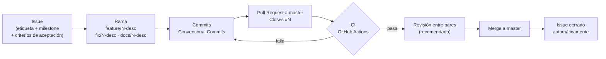

# Flujo de desarrollo del equipo

> Repositorio: [pswe07-CenfoCore-Jellyfin-web](https://github.com/jabarcar-cenfotec/pswe07-CenfoCore-Jellyfin-web) · Rama principal: `master`.

## 1. Vista general



## 2. Gestión de issues

Todo trabajo nace de un issue. Ningún cambio llega a `master` sin issue asociado.

| Elemento | Valores |
|---|---|
| Etiquetas | `enhancement`, `bug`, `documentation`, `ci`, `testing`, `playlist-sharing` (+ las predeterminadas de GitHub) |
| Milestones | **Entregable 2** (2026-11-09) · **Entregable final** |

Issues actuales:

| # | Título | Etiquetas | Milestone |
|---|---|---|---|
| [#1](https://github.com/jabarcar-cenfotec/pswe07-CenfoCore-Jellyfin-web/issues/1) | Mostrar usuarios con acceso a una playlist (solo lectura) | enhancement, playlist-sharing | Entregable 2 |
| [#2](https://github.com/jabarcar-cenfotec/pswe07-CenfoCore-Jellyfin-web/issues/2) | Gestionar permisos: agregar, cambiar y quitar usuarios | enhancement, playlist-sharing | Entregable final |
| [#3](https://github.com/jabarcar-cenfotec/pswe07-CenfoCore-Jellyfin-web/issues/3) | Pruebas automatizadas del diálogo | testing | Entregable 2 |
| [#4](https://github.com/jabarcar-cenfotec/pswe07-CenfoCore-Jellyfin-web/issues/4) | Configurar CI obligatorio en Pull Requests | ci | Entregable 2 |
| [#5](https://github.com/jabarcar-cenfotec/pswe07-CenfoCore-Jellyfin-web/issues/5) | Actualizar diagrama de arquitectura a C4 nivel 2 | documentation | Entregable 2 |
| [#6](https://github.com/jabarcar-cenfotec/pswe07-CenfoCore-Jellyfin-web/issues/6) | Guía de entorno local con usuarios de prueba | documentation | Entregable 2 |

Plantilla de cuerpo de issue:

```markdown
## Contexto
Por qué se necesita (enlace a jellyfin-web#4698 si aplica).

## Criterios de aceptación
- [ ] Dado <situación>, cuando <acción>, entonces <resultado observable>.

## Fuera de alcance
- ...
```

## 3. Estrategia de ramificación

Modelo de ramas cortas desde `master` (GitHub Flow).

| Regla | Detalle |
|---|---|
| Nombres | `feature/<issue>-<descripcion>`, `fix/<issue>-<descripcion>`, `docs/<issue>-<descripcion>` (ej. `feature/1-playlist-shares-list`) |
| Commits | [Conventional Commits](https://www.conventionalcommits.org/): `feat:`, `fix:`, `docs:`, `test:`, `ci:`, `chore:` |
| PR | Cuerpo con `Closes #N` para cerrar el issue al hacer merge |
| Protección de `master` | Cambios solo vía pull request; sin force push; sin eliminación; aprobación no obligatoria (equipo académico: la revisión entre pares se fomenta, no bloquea) |

## 4. GitHub Actions (CI)

El repositorio hereda los workflows de Jellyfin Web. En este repositorio se comportan así.

### PR hacia `master`: `.github/workflows/pull_request.yml`

| Job | Workflow reutilizable | Qué ejecuta | ¿Corre aquí? |
|---|---|---|---|
| Build | `__package.yml` | `npm ci` + `npm run build:production`; publica `dist` como artefacto `frontend` | Sí |
| Quality checks: dependencias | `__quality_checks.yml` | `actions/dependency-review-action` (dependencias vulnerables) | Sí |
| Quality checks: matriz | `__quality_checks.yml` | `npm run` de `build:es-check`, `lint` (ESLint), `stylelint`, `build:check` (`tsc --noEmit`) y `test` (Vitest) | Sí |
| CodeQL | `__codeql.yml` | Análisis `javascript-typescript` con consultas `security-and-quality` | Sí |
| Run eslint suggestions | (en línea) | Comenta sugerencias de ESLint en el PR | **No**: condicionado a `github.repository == 'jellyfin/jellyfin-web'` |

Todos los jobs toman la versión de Node de `.nvmrc` (24).

> **Importante:** `pull_request.yml` declara `paths-ignore: '**/*.md'`. Un PR que **solo** cambia archivos Markdown (como los de `docs/`) **no dispara** el CI. Si los checks se marcan como requeridos (issue #4), esos PR quedarían esperando checks que nunca corren; hay que considerarlo al configurar la protección de rama.

### Otros workflows heredados

| Workflow | Disparador | Comportamiento esperado aquí |
|---|---|---|
| `workflow_run.yml` | Al terminar "Pull Request" | `Metadata` usa solo `GITHUB_TOKEN`; `Automation` y `Deploy` requieren secretos de Jellyfin (`JF_BOT_TOKEN`, `CLOUDFLARE_*`) que este repositorio no tiene, por lo que no pueden cumplir su función |
| `push.yml` | Push a `master` (merge) | Repite build, quality checks y CodeQL; el despliegue está condicionado a `jellyfin/jellyfin-web` |
| `project-automation.yml` | Eventos de PR | Condicionado a `jellyfin/jellyfin-web`: se omite |
| `schedule.yml` | Cron diario | Condicionado a repositorios `jellyfin/`: se omite |

Comandos equivalentes en local, antes de abrir el PR:

```bash
npm run lint
npm run build:check
npm test
```

## 5. Estrategia de pruebas

| Nivel | Herramienta / método | Qué cubre | Cuándo |
|---|---|---|---|
| Unitarias y de componentes | Vitest (`npm test`) con mocks de `@jellyfin/sdk` | Renderizado de "Compartido con", estados vacío y error, mapeo de `CanEdit` a lectura / edición | En cada PR (CI) |
| Integración con API | Contra un servidor Jellyfin local ([entorno local](../entorno-local.md)) | Llamadas reales a `/Playlists/{playlistId}/Users` y respuestas del servidor | Antes de cerrar cada issue funcional |
| Funcionales / aceptación por rol | Manual, guiada por los criterios de aceptación | Ver tabla de roles | Antes del merge de #1 y #2 |
| Regresión | Vitest completo + lint + `tsc` en CI | Que no se rompa el editor de playlists ni el resto del cliente | En cada PR y en cada push a `master` |

Escenarios por rol (usuarios del [entorno local](../entorno-local.md)):

| Rol | Usuario de prueba | Resultado esperado |
|---|---|---|
| Propietario | `propietario` | Ve los usuarios con acceso y su permiso; en #2 puede agregar, cambiar y quitar |
| Editor | `editor` (`CanEdit = true`) | Puede editar el contenido de la playlist; no gestiona permisos |
| Lector | `lector` (`CanEdit = false`) | Ve la playlist; no puede modificarla |
| Sin acceso | `sinacceso` | No ve la playlist privada |
| Acceso abierto | cualquier usuario, con `OpenAccess = true` | Ve la playlist aunque no esté en `Shares` |

## 6. Definition of Done

- [ ] El issue tiene criterios de aceptación y todos se cumplen.
- [ ] Rama con nombre según la convención y commits en formato Conventional Commits.
- [ ] PR hacia `master` con `Closes #N` y descripción de cómo probar.
- [ ] CI en verde (build, quality checks, CodeQL) cuando el PR lo dispara.
- [ ] Pruebas Vitest nuevas o actualizadas para el comportamiento agregado.
- [ ] Verificación manual por rol cuando el cambio afecta la interfaz.
- [ ] Textos nuevos de la interfaz agregados a los archivos de traducción.
- [ ] Documentación actualizada si cambia el uso, la arquitectura o el entorno.

## 7. Evidencia

Completar con enlaces reales a medida que se ejecuta el flujo.

| Paso | Evidencia | Enlace | Responsable | Fecha |
|---|---|---|---|---|
| Issues y etiquetas | Lista de issues con etiquetas y milestone | _pendiente_ | | |
| Protección de `master` | Captura de la regla de protección | _pendiente_ | | |
| Rama y commits (#1) | `feature/1-playlist-shares-list` | _pendiente_ | | |
| PR (#1) | Pull request con `Closes #1` | _pendiente_ | | |
| Ejecución de CI | Run de "Pull Request" en Actions | _pendiente_ | | |
| PR de documentación (#5, #6) | Rama `docs/5-6-arquitectura-proceso` | _pendiente_ | | |
| Merge y cierre de issue | Issue cerrado por el PR | _pendiente_ | | |
| Pruebas por rol | Capturas del diálogo por usuario | _pendiente_ | | |
